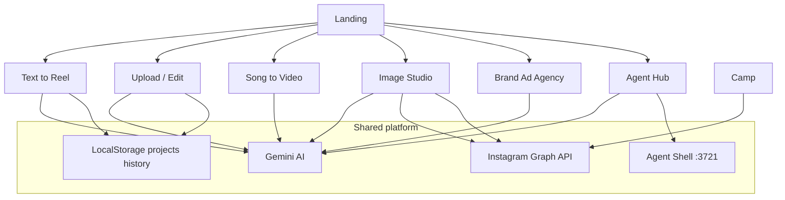
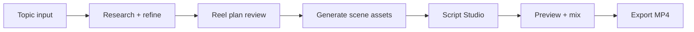
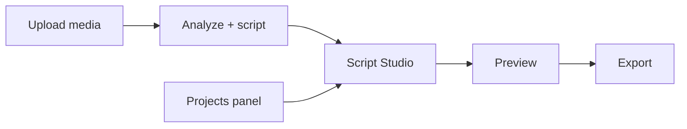
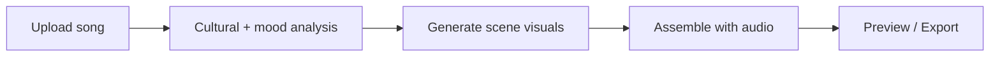
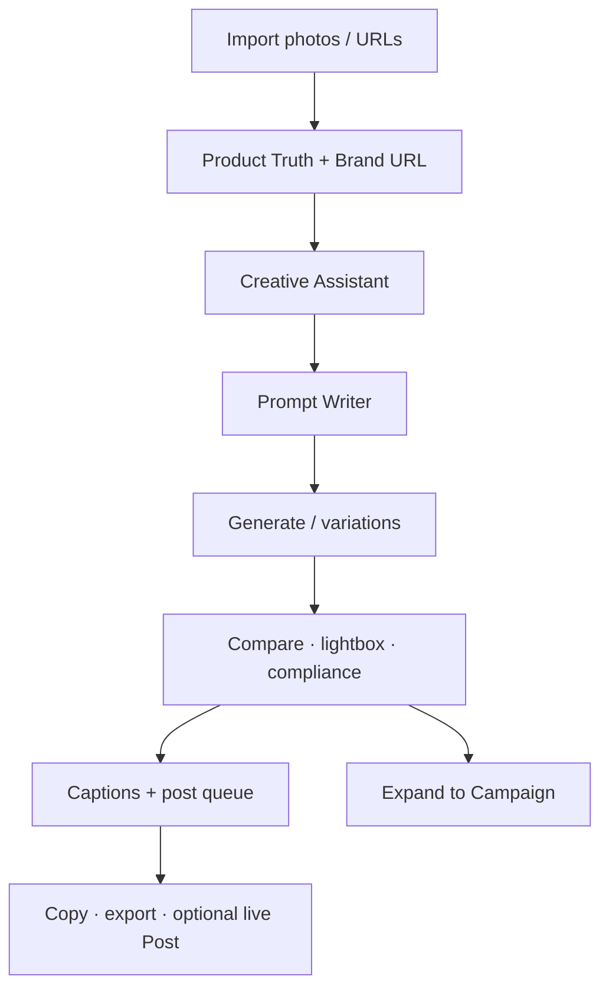
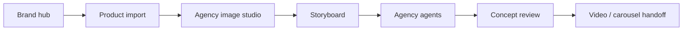
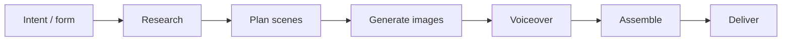

# ReelAI Studio

**Launch viral Instagram content in minutes.**

ReelAI Studio is an AI-native creative workspace for Instagram Reels, carousels, and brand ads. It connects research, scripting, image generation, voice, music, review, and export — so creators and brands can go from idea to post-ready assets without hopping between tools.

Built with React, Vite, and Google Gemini.

## Demo

[](https://github.com/veerupandey/ReelAI-public/blob/main/docs/demo/kageha-matcha-reel.mp4)

[Watch the 15-second reel](https://github.com/veerupandey/ReelAI-public/blob/main/docs/demo/kageha-matcha-reel.mp4) made with ReelAI's generated Kageha matcha clips.

---

## What you can build

| Mode | Best for |
|------|----------|
| **Text to Reel** | Prompt → researched storyboard → AI visuals → voice → export |
| **Upload Media** | Your clips/photos → AI script + assembly |
| **Song to Video** | Track → mood analysis → beat-synced visuals |
| **Image Studio** | Standalone AI images, captions, Instagram compose |
| **Brand Ad Agency** | Product-locked storyboards and agency production |
| **Agent Hub** | Autonomous ad pipeline with human approval gates |

---

## Quick start

```bash
git clone https://github.com/veerupandey/ReelAI-public.git
cd ReelAI-public
npm install
cp .env.local.example .env.local
```

Edit `.env.local`:

```bash
# Required — Google AI Studio → Gemini API key
GEMINI_API_KEY=your_google_gemini_key
VITE_API_KEY=your_google_gemini_key

# Optional — Google Neural TTS via agent shell (:3721)
# VITE_GOOGLE_TTS_ENABLED=true
# VITE_GOOGLE_TTS_URL=http://127.0.0.1:3721/tts
# GOOGLE_TTS_SERVICE_ACCOUNT_JSON={"type":"service_account",...}
```

```bash
npm run dev
# → http://localhost:3000
```

For Agent Hub (shell tools / ffmpeg) and Google TTS:

```bash
npm run dev:agent
```

> Never commit `.env.local`. It is gitignored. Use placeholders only in examples.

---

## System architecture

ReelAI is a single-page app. Navigation is a **creation-mode state machine** in `App.tsx` (no React Router). Each landing CTA sets a mode and advances through steps.



| Layer | Role |
|-------|------|
| `App.tsx` | Mode + step orchestration for all reel workflows |
| `components/` | Screens (Image Studio, Script Studio, Brand Agency, Campaign, Agents) |
| `services/` | Gemini, Instagram, captions, brand, autonomous agent, producers |
| `agents/` | Multi-agent brand-video orchestrator |
| `campaign-manager/` | Autonomous campaign planner / executor |
| `runtime/` | Agent Hub intent routing + tool execution |
| `scripts/agent-shell-server.cjs` | Local ffmpeg / Python / MCP tools for Agent Hub |

---

## Product flows

### 1. Text to Reel

**Purpose:** Turn a topic into a finished vertical reel.



1. Enter a topic (optional persona, references, viral ideas).
2. Gemini agents refine the brief and pull trend / product / viral context.
3. A scene-by-scene `ReelPlan` is proposed for review.
4. Images are generated per scene; Script Studio lets you rewrite, regenerate, and route visuals.
5. Add voiceover (Gemini / Google TTS / record) and music.
6. Preview on a 1080×1920 canvas and export Instagram-ready MP4.

**Key files:** `App.tsx`, `components/ScriptStudio.tsx`, `services/geminiService.ts`, `components/ReelPreview.tsx`

---

### 2. Upload Media / Edit Existing

**Purpose:** Start from your own footage or resume a saved project.



1. Upload images/clips (or open a saved project).
2. Media is analyzed into scene drafts and a script.
3. Continue through Script Studio → Preview → Export (same tail as Text to Reel).

**Key files:** `components/MediaInput.tsx`, `components/ProjectsPanel.tsx`, `utils/sceneDrafts.ts`

---

### 3. Song to Video

**Purpose:** Build a reel that follows the mood and structure of a track.



1. Upload audio (optional character reference).
2. Gemini analyzes cultural context, energy, and structure.
3. Scene images are generated in parallel for the timeline.
4. The song becomes the background track in the standard preview/export path.

**Key files:** `components/SongToVideoStudio.tsx`, `services/geminiService.ts` (`analyzeSongCulturalContext`, `generateSongVisuals`)

---

### 4. AI Image Studio

**Purpose:** Standalone image creation for social — grounded on product truth and brand, with captions and Instagram compose.



1. **Import** product images and an optional shared brand URL.
2. **Creative Assistant** researches brand/trends and proposes concepts + strategist brief.
3. **Prompt Writer** turns direction into production prompts.
4. **Generate** images (batch variations, adapt format, brand compliance).
5. **Compose Instagram** — research-driven captions (no IG tokens required for generate/edit/copy); live Post needs Graph API + public image hosting.
6. Sessions **autosave** (browser + on-disk `studio-projects/` in local dev); named **Projects** for Save / Open / Export JSON.

**Key files:** `components/AIImageStudio/AIImageStudioScreen.tsx`, `useStudioReducer.ts`, `captionService.ts`, `InstagramPostPanel.tsx`, `studioSessionResume.ts`

---

### 5. Brand Ad Agency

**Purpose:** Product-locked brand production — from catalog import to storyboard and agent-run concept approval.



1. Create or select a brand.
2. Import a product URL → lock product identity and assets.
3. Curate / generate product shots in the agency image studio.
4. Plan a storyboard (platform, format, scene routes: use imported vs generate).
5. Agents produce a campaign blueprint for concept review.
6. Approve → hand off to Agent Console (video ads) or stay on concept review (static/carousel).

**Key files:** `components/BrandVideoCreator.tsx`, `agents/AgentOrchestrator.ts`, `services/brandService.ts`, `services/productPageImportService.ts`

---

### 6. Agent Hub (autonomous)

**Purpose:** End-to-end ad production with human-in-the-loop gates.



Phases run under `AutonomousAgent` with optional approval at concept, scenes, and visuals. Local shell server (`:3721`) provides ffmpeg and file staging for video assembly.

```bash
npm run dev:agent   # Vite + agent shell together
```

**Key files:** `components/AgentHub.tsx`, `components/AgentConsole.tsx`, `services/autonomousAgent.ts`, `scripts/agent-shell-server.cjs`

---

### 7. Instagram captions & publish

| Capability | Needs IG tokens? |
|------------|------------------|
| Generate / edit / retry / revise captions | No |
| Copy caption + hashtags | No |
| Export ordered pack | No |
| Live **Post to Instagram** | Yes — `VITE_IG_*` + public image host (not configured in this build) |

Captions use image grounding + brand/product context and optional live trend research (Gemini + Google Search).

---

## Configuration

### Required

| Variable | Purpose |
|----------|---------|
| `GEMINI_API_KEY` | Server/build-time Gemini key (`vite.config.ts`) |
| `VITE_API_KEY` | Client-side Gemini access (same key) |

### Optional

| Variable | Purpose |
|----------|---------|
| `VITE_IG_ACCESS_TOKEN` / `VITE_IG_BUSINESS_ACCOUNT_ID` | Live Instagram publish (needs public image host) |
| `VITE_GOOGLE_TTS_ENABLED=true` | Enable Google Neural TTS voices in the UI |
| `VITE_GOOGLE_TTS_URL` | TTS proxy URL (default `http://127.0.0.1:3721/tts`) |
| `GOOGLE_TTS_SERVICE_ACCOUNT_JSON` | Service account JSON for shell-server `/tts` |
| `VITE_SUBAGENT_MODEL` / `VITE_ORCHESTRATOR_MODEL` / `VITE_VEO_MODEL` | Model overrides for agents / Veo |
| `GEMINI_IMAGE_MODEL` / `VITE_GEMINI_IMAGE_MODEL` | Override Gemini image model id (default Nano Banana 2.1 / `gemini-nano-banana-2.1`) |

Get a Gemini key: [Google AI Studio](https://aistudio.google.com/apikey).

---

## Scripts

| Command | Description |
|---------|-------------|
| `npm run dev` | Vite dev server (`http://localhost:3000`) |
| `npm run build` | Production build → `dist/` |
| `npm run preview` | Preview production build |
| `npm run agent:server` | Agent shell / MCP on port **3721** |
| `npm run dev:agent` | Vite + agent shell together |

---

## Tech stack

- **UI:** React 19, TypeScript, Vite 6
- **AI:** `@google/genai` (Gemini — text, image, TTS, research, agents)
- **Persistence:** LocalStorage (projects / history); local always-on session
- **TTS / tools:** Agent shell server (`:3721`) for Google TTS, ffmpeg, MCP
- **Video:** Canvas compositor (1080×1920 Instagram profiles)
- **Agents:** Custom orchestrators + MCP SDK + local shell tooling
- **Tests:** Vitest, Testing Library, Playwright

---

## Repo map

```
App.tsx                 # Landing + reel workflow orchestration
components/
  AIImageStudio/        # Image Studio (assistant, writer, captions, projects)
  ScriptStudio.tsx      # Scene editor for reels
  BrandVideoCreator.tsx # Brand Ad Agency
  AgentHub.tsx          # Autonomous entry
services/               # Gemini, Instagram, agents, brand, producers
agents/                 # Brand multi-agent runtime
runtime/                # Agent Hub routing
scripts/                # agent-shell-server (TTS, ffmpeg, MCP)
```

---

## Security notes

- Keep API keys in `.env.local` only — never commit real credentials.
- `.env.local.example` contains placeholders only.
- Rotate any key that may have appeared in git history.
- This local-development app uses Gemini keys in the browser. Vite embeds `VITE_*` values and the configured Gemini key in served JavaScript; use a server-side proxy before hosting it for untrusted users.
- Secret scanning runs in GitHub Actions. Keep generated builds, browser logs, and local output out of commits.

---

## Contributing

1. Fork and clone
2. `git checkout -b feature/your-change`
3. Commit with a clear message
4. Open a PR against `main`

---

## License

Proprietary — contact the project owners for usage rights.
